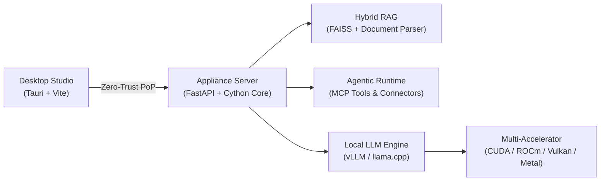

<!-- Header Banner -->

<h3>Building Sovereign, Air-Gapped AI Appliances & High-Performance Local LLM Systems</h3>

  
  
  

---

### 👨‍💻 About Me

  <a href="https://solimatics.co.kr" target="_blank">
    <picture>
      <source media="(prefers-color-scheme: dark)" srcset="./assets/solimatics-logo-dark.png" />
      <source media="(prefers-color-scheme: light)" srcset="./assets/solimatics-logo.png" />
      
    </picture>
  </a>
   
  Currently Engineer at <b>SOLIMATICS</b> — Building Enterprise Sovereign AI Appliance

데이터 유출 없는 **온프레미스·폐쇄망(Air-Gapped) AI 인프라**와 **크로스 플랫폼 네이티브 소프트웨어**를 설계하고 구현합니다.  
초거대 언어 모델(LLM)의 로컬 서빙 최적화부터 하이브리드 RAG, 에이전틱 워크플로우, 네이티브 바이너리 보호 및 배포 자동화까지 엔드투엔드(End-to-End) 시스템을 다룹니다.

- 🔭 **Currently working on:** Enterprise Sovereign AI Appliance (Local LLM Serving, Hybrid RAG, Agentic Workspace)
- ⚡ **Core Interests:** GPU Offloading (`CUDA` / `ROCm` / `Vulkan` / `Metal`), Inference Optimization (`vLLM`, `llama.cpp`), Zero-Trust Security
- 🛠️ **Engineering Approach:** Zero-Dependency Packaging, Deterministic Pipelines, Native Performance (`C++`, `Rust`, `Cython`)

---

### 🧩 Engineering Focus

| Domain | What I Build |
| :--- | :--- |
| **🧠 Local LLM & Inference** | 소비자/엔터프라이즈 GPU 환경에서의 양자화 모델 서빙, 멀티 가속기 자동 감지 및 오프로드 파이프라인 |
| **🔎 Hybrid RAG & Agents** | 사내 문서(PDF/Office/HWPX) 파싱, 벡터·키워드 하이브리드 검색(FAISS), MCP 기반 에이전트 오케스트레이션 |
| **🖥️ Cross-Platform Studio** | `Tauri` + `Vite` 기반 네이티브 데스크톱 AI 스튜디오 및 Windows / Linux / macOS 단일 파일 인스톨러 구축 |
| **🛡️ Systems & Security** | 네이티브 성능 최적화, Zero-Trust 인증 아키텍처 및 폐쇄망(Air-Gapped) 배포 자동화 |

---

### 🏗️ Typical System Architecture I Build

---

### 🛠️ Tech Stack

#### Languages

#### AI / LLM & Inference

#### Backend, Desktop & Infrastructure

#### Databases & Tools

<!-- Footer Banner -->

